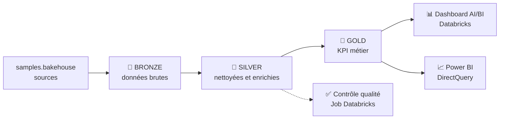
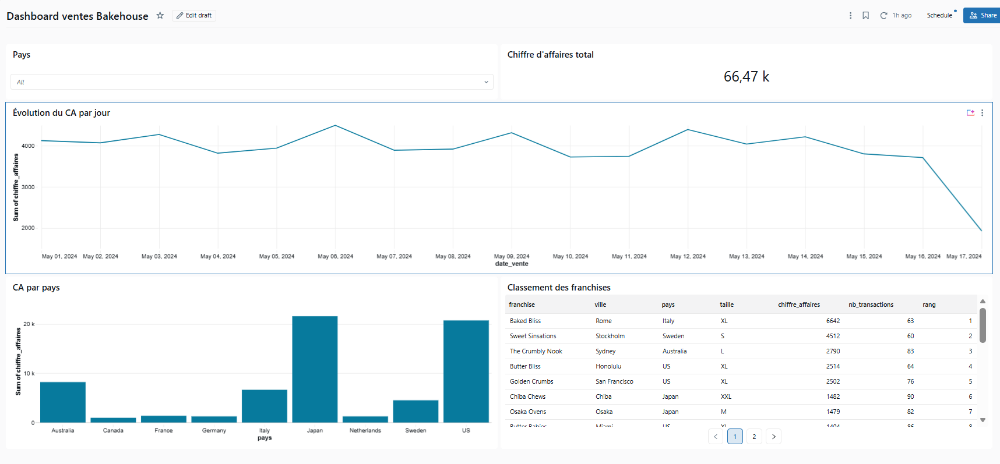
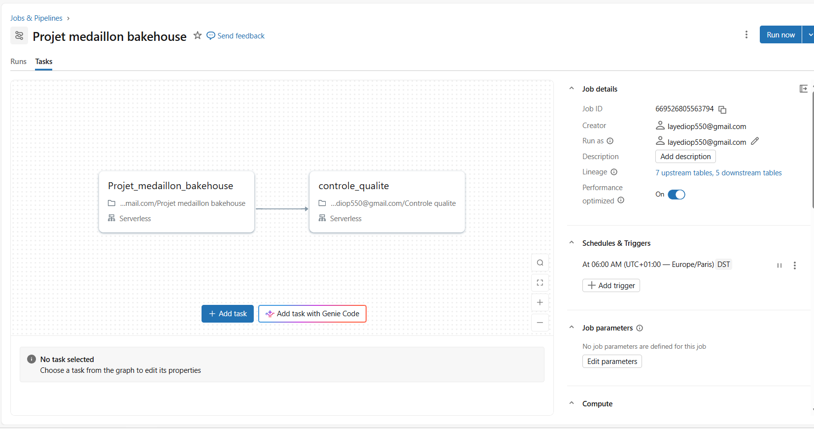
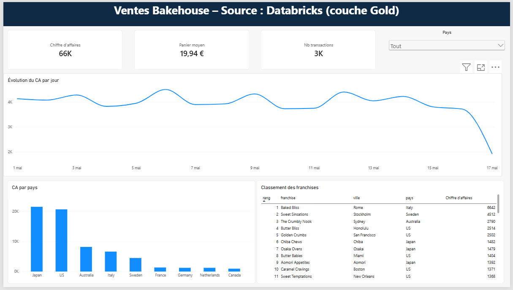
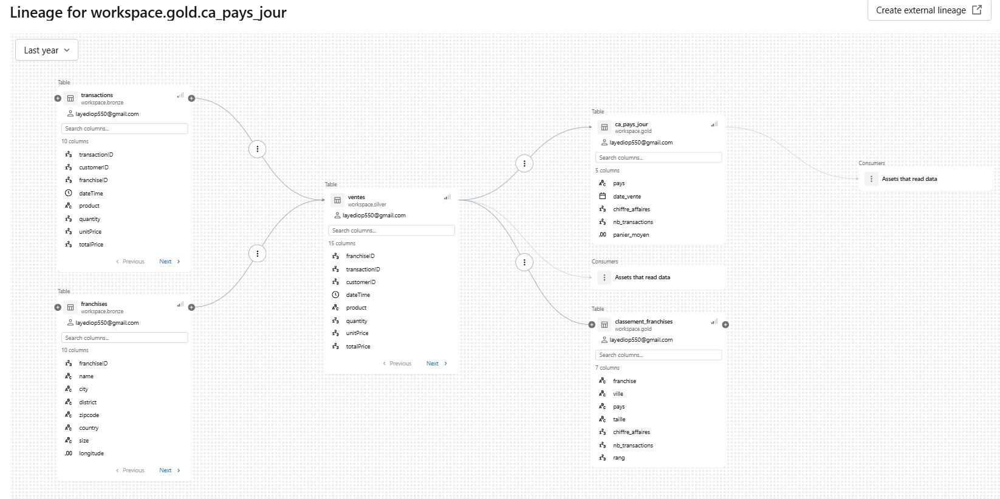
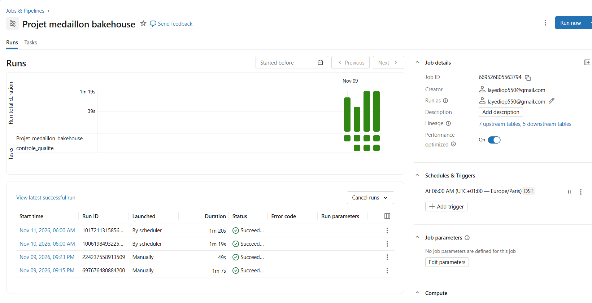

# 🥐 Pipeline médaillon & dashboard des ventes — Databricks

Projet personnel de **Data Analyst / Analytics Engineer** réalisé sur **Databricks (Free Edition)** : construction d'un pipeline de données **Bronze → Silver → Gold**, orchestration quotidienne avec contrôle qualité, dashboard AI/BI et restitution dans **Power BI**.

**Auteur :** Abdoulaye DIOP — Data Analyst · [LinkedIn](https://www.linkedin.com/in/abdoulaye~diop/)

---

## 🎯 Objectif

À partir des ventes d'une chaîne internationale de boulangeries (jeu de données `samples.bakehouse` fourni par Databricks), produire des **indicateurs fiables** (chiffre d'affaires, transactions, panier moyen, classement des franchises) et les mettre à disposition des équipes métier.

## 🏗️ Architecture



| Couche | Tables | Traitements |
|---|---|---|
| 🥉 Bronze | `bronze.transactions`, `bronze.franchises` | Copie brute des sources |
| 🥈 Silver | `silver.ventes` | Dédoublonnage, filtres de cohérence, calcul du montant, jointure avec les franchises, **suppression du numéro de carte (RGPD)** |
| 🥇 Gold | `gold.ca_pays_jour`, `gold.classement_franchises` | CA, nb de transactions, panier moyen par pays et par jour, classement des franchises (`RANK() OVER`) |

## 🛠️ Stack technique

- **Databricks** : notebooks, Databricks SQL, SQL Warehouse serverless
- **PySpark** et **SQL** (CTAS, fonctions de fenêtre)
- **Delta Lake** : `MERGE` (upsert), `UPDATE`, **Time Travel**, `RESTORE`, `DESCRIBE HISTORY`
- **Unity Catalog** : catalogue → schéma → table, commentaires, lignage, droits
- **Databricks Jobs** : planification quotidienne (cron), tâches dépendantes, alerte email en cas d'échec
- **Dashboard AI/BI** Databricks (KPI, courbe, barres, tableau, filtre)
- **Power BI Desktop** connecté au SQL Warehouse (DirectQuery, token à scope limité) + mesures **DAX**

## 📂 Contenu du dépôt

```
notebooks/
  01_pipeline_medaillon.py    # Bronze → Silver → Gold (PySpark + SQL)
  02_controle_qualite.py      # Tâche de contrôle qualité du Job
  00_delta_lake_demo.sql      # MERGE, Time Travel, RESTORE
sql/
  gold_kpi.sql                # Tables Gold
powerbi/
  mesures_dax.md              # Mesures DAX
  Ventes_Bakehouse_Databricks.pbix
images/                       # Captures du dashboard, du Job, de Power BI
```

## ⚙️ Orchestration

Job Databricks planifié **tous les jours à 6 h (Europe/Paris)** :

1. `Projet_medaillon_bakehouse` : reconstruit Bronze, Silver et Gold
2. `controle_qualite` *(dépend de la tâche 1)* : fait **échouer le job** s'il y a des doublons ou si la table Gold est vide → **email d'alerte**

## 📊 Résultats

- **66,5 k€** de chiffre d'affaires, **3 333 transactions**, panier moyen de **19,94 €**
- **Japon** : 1er marché (≈ 1/3 du CA)
- Contrôles qualité : **0 doublon**, **0 vente sans franchise**

## 🔍 Analyses et points d'attention

- **Panier moyen anormal** : *Baked Bliss* (Rome) affiche un panier de **105 €** contre 15 à 20 € ailleurs. L'investigation montre un prix unitaire normal (3 €) mais des quantités **par lots de 6 (6 à 60 articles)** → probablement des **ventes en gros (B2B)**. Recommandation : segmenter l'analyse B2B / particuliers.
- **Chute du CA le 17 mai** : journée **incomplète** dans les données (≈ 106 transactions contre ≈ 200 habituellement), et non une vraie baisse d'activité.
- **Modélisation Power BI** : le panier moyen est calculé par une **mesure DAX** (`DIVIDE`) et non par la somme d'une colonne de ratios, qui donnerait un résultat faux.

## 🖼️ Captures

| Dashboard AI/BI | Job Databricks |
|---|---|
|  |  |

| Power BI | Lignage Unity Catalog |
|---|---|
|  |  |

| Exécution automatique quotidienne (Job planifié à 6 h) |
|---|
|  |
